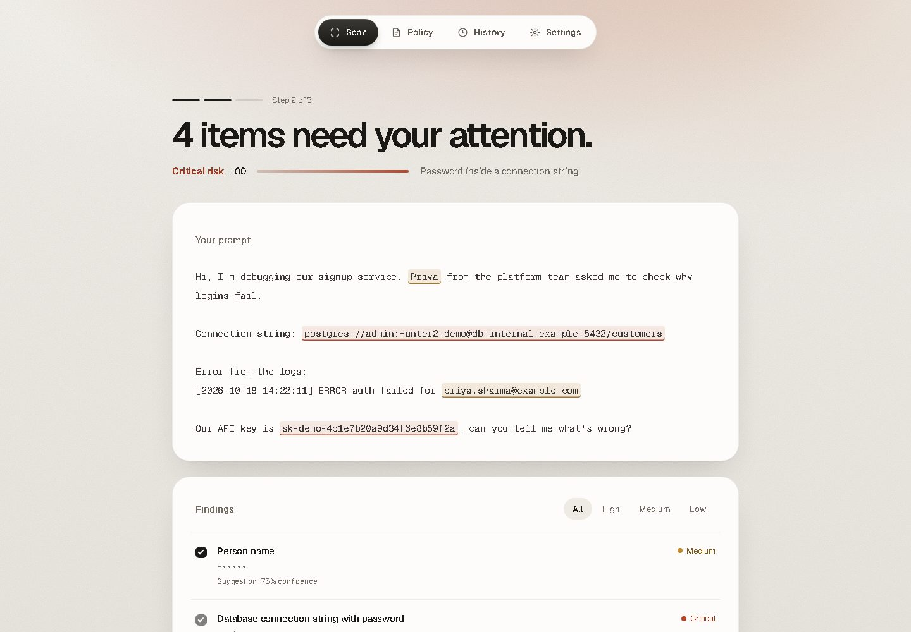
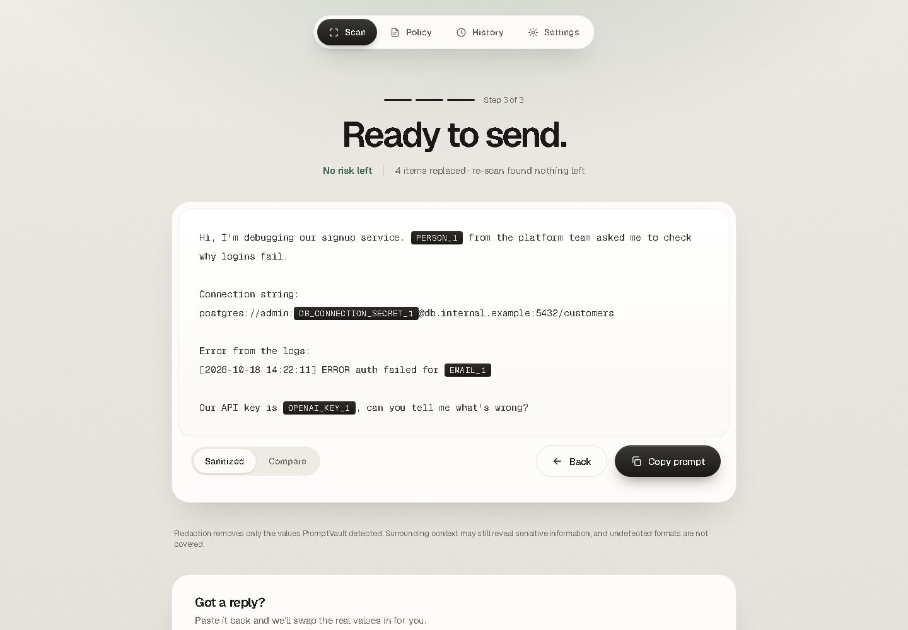

# PromptVault

**Check before you send. A privacy firewall for AI prompts that runs entirely in your browser.**

PromptVault finds secrets and personal data in text before you paste it into ChatGPT, Claude or any other AI tool. It scores the risk, applies a policy you control, replaces sensitive values with typed placeholders, then re-scans its own output to confirm nothing was left behind. Scanning runs in a Web Worker, and the production build forbids network connections, so a prompt has nowhere to go.

| Review: findings highlighted, credentials locked | Sanitized: placeholders, re-scan verified |
|---|---|
|  |  |

## How it works

1. **Write.** Paste a prompt or attach a text file (read locally). Choose Strict or Permissive.
2. **Review.** Findings are highlighted with category, masked value and decision. Credentials, keys, seed phrases and database connection strings are locked and always removed; lower-risk items are your call.
3. **Sanitized.** Copy the redacted prompt (`[EMAIL_1]`, `[AWS_ACCESS_KEY_1]`). A re-scan of the output says whether it is clean, and lists anything left. Paste the AI's reply back to restore the real values (in memory only).

Also in the app: a **Policy** editor with custom keyword and regex rules, opt-in count-only **History**, and a **Settings** page with a live attack suite and a failure drill that forces every detector to fail so you can watch the scan block.

## Why you can trust it

Only claims that are implemented and tested:

- **Local only.** The scan runs in a `blob:` Web Worker that disables `fetch`, `XMLHttpRequest`, `WebSocket`, `EventSource`, `WebTransport` and `sendBeacon` before loading anything. Playwright tests in Chromium, Firefox and WebKit check for zero prompt egress.
- **CSP `connect-src 'none'`** in production builds (`build/csp.ts`; not applied by the dev server).
- **Fails closed.** A detector error, a 5 s timeout, an invalid policy or an unsafe custom regex never yields a clean result.
- **Safety floor.** Credential-class findings stay mandatory redact or block under any policy.
- **Signed policies.** ECDSA P-256 bundles with rollback protection. No trusted keys ship by default, so imports are refused until an organisation adds one.
- **Storage.** Only your saved policy (including custom rule terms you type), settings, and opt-in activity counts stay in the browser. Prompt text and placeholder mappings are never stored.

## Quick start

```bash
npm ci
npm run dev                          # development
npm run build && npm run preview     # production build with the CSP (use this to demo)
```

## Honest metrics

The 107-case regression corpus scores 100%, but it is synthetic tuning data, not evidence of real-world accuracy. The only blind result is run 1: **94.2% precision, 90.7% recall** on 40 cases; later runs are tuned. See [Limitations](docs/LIMITATIONS.md).

## Docs

| Doc | What it covers |
|---|---|
| [docs/DEMO.md](docs/DEMO.md) | Timed 3 to 4 minute demo script |
| [docs/SPEC.md](docs/SPEC.md) | Condensed product spec |
| [docs/LIMITATIONS.md](docs/LIMITATIONS.md) | What it does not do |
| [docs/DETECTORS.md](docs/DETECTORS.md) | Generated detector catalog (81 detectors) |
| [docs/DEVELOPMENT.md](docs/DEVELOPMENT.md) | Scripts, stack, layout, governance, deployment |
| [docs/THREAT_MODEL.md](docs/THREAT_MODEL.md) | Threat model |

Stack: Vite, React 19, TypeScript, Zod, compromise (local NLP), Vitest, Playwright. All test data is synthetic.
